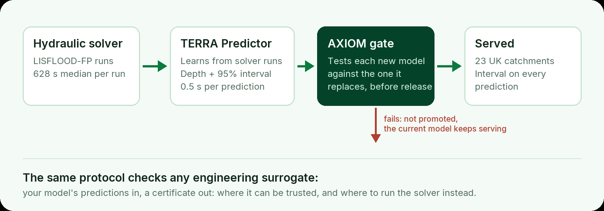

  

  
  
  

<strong>Flood prediction that tells you how far to trust it, and a protocol that holds any engineering ML surrogate to the same standard.</strong>

<table align="center">
  <tr>
    <td align="center" width="25%"><h2>1,200×</h2>faster than the LISFLOOD-FP solver 0.5 s against 628 s</td>
    <td align="center" width="25%"><h2>94.6%</h2>of cells inside the stated 95% band per cell · 49.0% per run</td>
    <td align="center" width="25%"><h2>23</h2>UK catchments served today by the emulator</td>
    <td align="center" width="25%"><h2>5</h2>physics through one validation protocol AXIOM v1.2</td>
  </tr>
</table>

Every figure is measured. Where a stricter measure gives a weaker number, we publish it beside the stronger one.

## How it fits together

  

## What we build

<table>
  <tr>
    <th width="50%">TERRA Predictor</th>
    <th width="50%">AXIOM</th>
  </tr>
  <tr>
    <td valign="top"><em>Flood depth in half a second</em>
      <ul>
        <li>Machine-learning emulator trained on LISFLOOD-FP hydraulic simulations</li>
        <li>A conformal prediction interval with every prediction, calibrated against the solver</li>
        <li>Comparison against observed floods comes next</li>
      </ul>
    </td>
    <td valign="top"><em>The test any engineering surrogate has to pass</em>
      <ul>
        <li>Works with any solver and any model architecture</li>
        <li>States where a surrogate can be trusted, and routes the rest to the solver</li>
        <li>Usual ±1.96σ intervals held 40 to 80% of true values at a claimed 95%; AXIOM's held 94.3 to 95.3%</li>
      </ul>
      Open specification coming soon.
    </td>
  </tr>
</table>

## Who we work with

| | We answer |
| --- | --- |
| **Owners of flood-exposed assets** water utilities, infrastructure operators, asset managers | Which sites will flood, how deep, and how sure that answer is |
| **Engineering simulation teams** groups that train ML surrogates | Where a surrogate can be trusted before anyone relies on it |

  <strong>See TERRA on your sites, test a surrogate against AXIOM, or partner with us:</strong> 
  <a href="https://www.finkele.com/#contact">book a 20-minute demo</a> · <a href="https://www.finkele.com">finkele.com</a>

<strong>Recognised by</strong> Accelerate Cambridge (Cambridge Judge Business School) · Cambridge Independent Science &amp; Technology Awards 2026, Cleantech finalist · HCR Impact55 finalist

