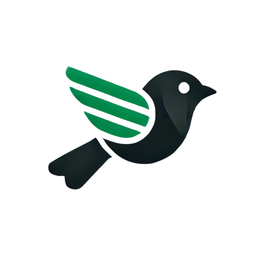

  

<h1 align="center">Finkele</h1>

  <strong>Climate intelligence for resilient assets.</strong> 
  Real-time flood alerts, flood risk mapping and financial loss estimation, so asset owners act before the next flood rather than after it.

  
  
  

---

## Live today

| | Product | What it does |
| :---: | --- | --- |
| 🚨 | [**Flood Alert**](https://finkele.com/alert.html) | Live flood warnings for England and Scotland: about 3,000 stations, refreshed every 5 minutes from Environment Agency and SEPA data. |
| 🗺️ | [**Flood Risk Map**](https://finkele.com/floodmap.html) | Flood depth across 10 to 500-year return periods, with risk and financial loss estimates per asset. |
| 🌡️ | [**Climate Dashboard**](https://finkele.com/climate.html) | ESG metrics, climate trends and AI-driven risk predictions. |

## The technology underneath

| | Technology | What it does |
| :---: | --- | --- |
| ⚡ | **TERRA** | An ML flood emulator trained on real solver output: milliseconds instead of hours, with a calibrated confidence interval on every prediction. |
| 🛰️ | **GroundVerify** | Checks flood predictions against what actually happened, using independent Sentinel-1 satellite radar of the real event rather than another model's opinion. |
| 🧪 | **Axiom** | Our protocol for validating ML surrogates in engineering simulation: coverage guarantees, risk detection, and a handoff to the full solver whenever a prediction cannot be trusted. The test any surrogate has to pass. Open specification coming soon. |

## Recognition

- **Selected** for Accelerate Cambridge, Cambridge Judge Business School's startup accelerator
- **Finalist**, Cleantech Company of the Year, Cambridge Independent Science & Technology Awards 2026
- **Finalist**, HCR Impact55: one of 11 national finalists driving positive environmental change

## Who it's for

Water utilities, asset managers and infrastructure operators who need climate intelligence they can act on, not raw data.

## Get in touch

Partnering, integrating our data, or seeing it on your own assets: [book a 20-minute demo](https://www.finkele.com/#contact) or write to us through [finkele.com](https://www.finkele.com).

Built in the United Kingdom · Building climate resilience, one data point at a time.

