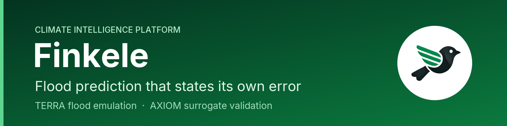

  

  
  
  

We build flood prediction that tells you how far to trust it, and a protocol that holds any engineering ML surrogate to the same standard. Every number below is measured, and we publish the weaker figure beside the stronger one.

## TERRA Predictor: flood depth in half a second

A machine-learning emulator trained on LISFLOOD-FP hydraulic simulations. One prediction takes **0.49 to 0.53 s** where the solver's median run takes **628 s**, roughly **1,200 times faster**, and it serves **23 UK catchments** today.

Every prediction comes with a conformal prediction interval. On a catchment the model never trained on, **94.6% of cells** fell inside the stated 95% band. That is a per-cell figure: measured per run, which is far stricter, it is **49.0%**. The interval is calibrated against the solver; comparison against observed floods comes next.

## AXIOM: the test any engineering surrogate has to pass

A protocol for validating ML surrogates that works with any solver and any architecture. It states where a surrogate can be trusted, with measured coverage and a bound on peak-region risk, and routes everything else back to the solver.

On held-in test data across four physics, the usual ±1.96σ intervals contained only **40 to 80%** of true values while claiming 95%; AXIOM's calibrated intervals contained **94.3 to 95.3%**. Version 1.2 runs unchanged across five physics, including five published NVIDIA models scored on NVIDIA's own held-out split. The open specification is coming soon.

## Who we work with

- **Owners of flood-exposed assets:** water utilities, infrastructure operators and asset managers who need to know which sites will flood, how deep the water will get, and how sure that answer is.
- **Engineering simulation teams:** groups that train ML surrogates and need to show where a surrogate can be trusted before anyone relies on it.

## Work with us

Want to see TERRA on your own sites, test a surrogate against AXIOM, or explore a partnership? [Book a 20-minute demo](https://www.finkele.com/#contact) or reach us at [finkele.com](https://www.finkele.com).

<strong>Recognised by</strong> Accelerate Cambridge (Cambridge Judge Business School) · Cambridge Independent Science &amp; Technology Awards 2026, Cleantech finalist · HCR Impact55 finalist

